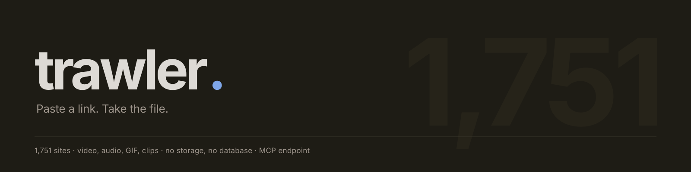
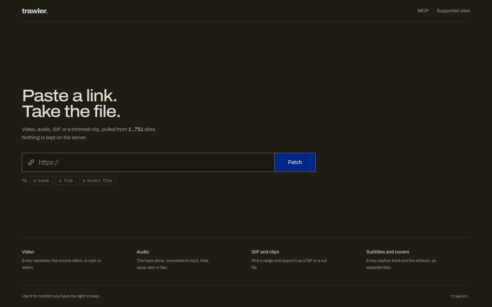
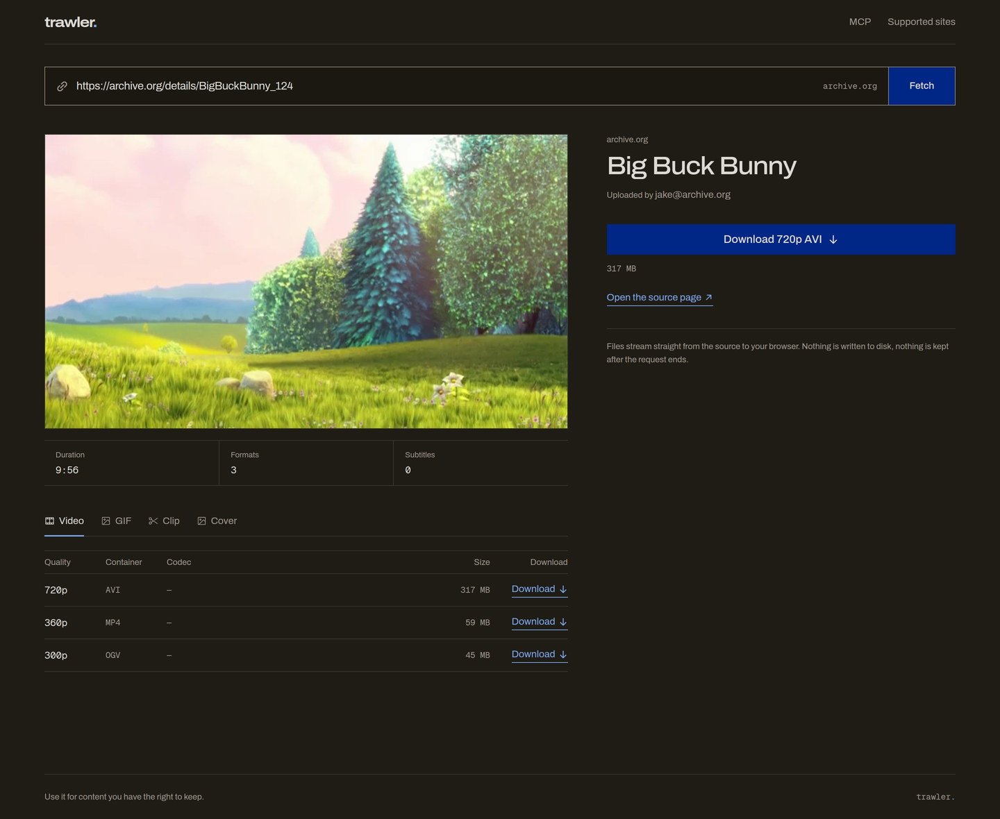
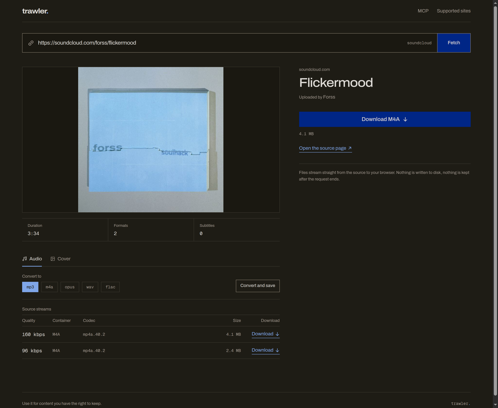
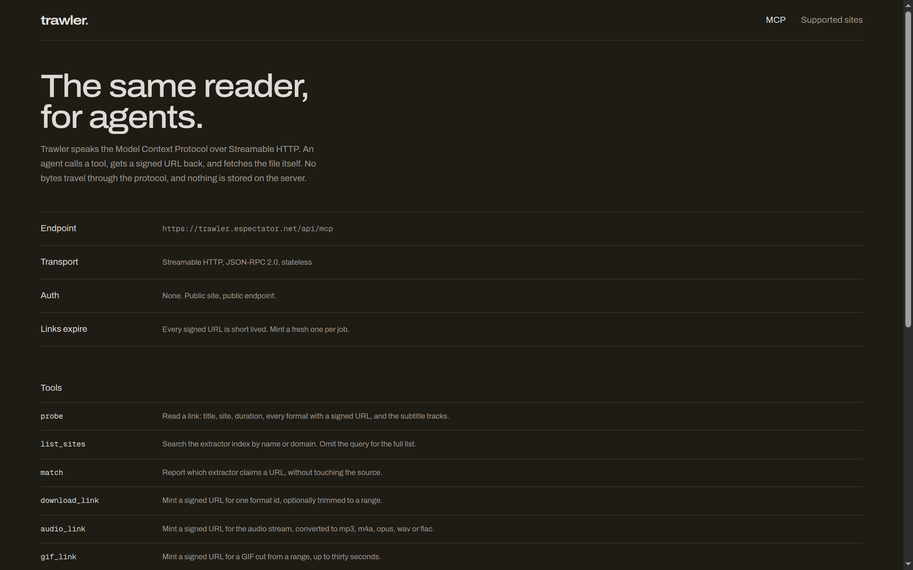

<div align="center">



<br>

<a href="https://trawler.espectator.net"></a>




</div>

A media reader that takes a link, shows you what is behind it, and streams the file you pick straight
to your browser. Video in every resolution the source offers, audio converted on the way out, GIFs
and clips cut from a range, subtitles and cover art as separate files.

There is no account, no history, no queue and no storage. A request is the whole job: it either
returns bytes or it returns an error.

```
1,751 extractors   ·   video · audio · GIF · clips   ·   0 bytes written to disk   ·   0 tables
```

## What it does

- **Reads before it downloads.** Pasting a link runs a metadata probe: title, duration, source,
  cover, caption tracks and every format the extractor exposes, with real file sizes. You choose
  from facts instead of guessing at a filename.
- **Plays before you commit.** Progressive sources get an inline player; audio sources get an audio
  element with the artwork behind it. HLS-only sources fall back to the cover, and still download.
- **Every format, not a favourite.** The table lists each stream the source publishes — container,
  codec, resolution, bitrate, size — and each row is its own download.
- **Converts on the way out.** Audio to mp3, m4a, opus, wav or flac through ffmpeg, without ever
  landing on disk.
- **Cuts GIFs and clips.** Pick a start and an end; export a GIF at a chosen width and frame rate, or
  a trimmed file. The range is enforced by ffmpeg, not by a client-side scrubber.
- **Carries the paperwork.** Subtitle tracks in every language the source offers, and the cover art,
  as separate downloads.
- **One input for all of it.** The same field takes a video page, a track, a playlist or a direct
  file, and names the source as you type.

## Why there is no database

A downloader normally needs somewhere to keep a job. This one keeps the job in the URL.

A probe resolves the media, then seals what it learned into a signed ticket — media URL, the headers
the CDN expects, filename, container, companion audio stream, expiry. Downloads verify the signature
and act on the ticket, so the server can only ever fetch URLs it minted itself, and they expire.

```
base64url(zlib(json{ u, h, n, x, p, a, e })) + "." + hmac_sha256[:24]
```

That one decision removes the database, the cleanup job, the orphan sweep and the stuck-queue
dashboard. Restart the container mid-download and the next request still works, because there was
never any state to lose.

### The three download paths

| Source | Path | Cost |
| --- | --- | --- |
| one muxed file, no trim | range proxy through httpx | no CPU, resumable, `206` |
| separate video and audio | `ffmpeg -i v -i a -c copy` into fragmented MP4 | copy only, no transcode |
| trim, convert, GIF | ffmpeg filter or encoder into the response | CPU bound, capped at 4 concurrent |

Merged and trimmed output is fragmented MP4 (`+frag_keyframe+empty_moov`), so the moov atom sits at
the front and bytes can be written to a pipe with no seeking. The trade-off is honest: no
`Content-Length`, so no resume and no exact percentage on those paths. Direct proxies keep both.

## The interface



*One probe of an archive.org item: preview, duration, three resolutions with real sizes, and a single
primary action. Trim, GIF and conversion controls sit on the same page.*

<table>
<tr>
<td width="50%" valign="top">
<br>
<sub><b>Audio.</b> Artwork, duration, and a conversion row — mp3, m4a, opus, wav, flac — before anything is downloaded.</sub>
</td>
<td width="50%" valign="top">
<br>
<sub><b>Agents.</b> The same reader over MCP: endpoint, transport and seven tools, documented on the site.</sub>
</td>
</tr>
</table>

## API

| Method | Path | Purpose |
| --- | --- | --- |
| GET | `/api/health` | extractor count and readiness |
| GET | `/api/sites` | full extractor index, optional `?q=` |
| GET | `/api/match?url=` | which extractor claims a URL |
| POST | `/api/probe` | metadata, formats, subtitles, one ticket per format |
| GET | `/api/preview/{ticket}` | range-aware proxy for the player |
| GET | `/api/dl/{ticket}` | the file, `?start=&end=` to trim, `?to=mp3` to convert |
| GET | `/api/gif/{ticket}` | animated GIF, `?start=&end=&width=&fps=` |
| GET | `/api/thumb/{ticket}` | cover art |
| GET | `/api/sub/{ticket}` | one subtitle track |
| POST | `/api/mcp` | MCP server, Streamable HTTP |

## MCP

`https://trawler.espectator.net/api/mcp` — Streamable HTTP, JSON-RPC 2.0, stateless, no key. It is
mounted on the same FastAPI app and reached through the `/api` rewrite the browser already uses, so
there is no second service and no extra route.

| Tool | Returns |
| --- | --- |
| `probe` | title, site, duration, formats with signed URLs, subtitles |
| `list_sites` | extractor index, optional query |
| `match` | which extractor claims a URL |
| `download_link` | signed URL for one format, optionally trimmed |
| `audio_link` | signed URL for converted audio |
| `gif_link` | signed URL for a GIF range |
| `subtitle_link` | signed URL for a caption track |

Tools never move bytes. They return absolute signed URLs and the client fetches them over plain
HTTP, which keeps a 300 MB file out of the protocol.

```json
{
  "mcpServers": {
    "trawler": {
      "type": "http",
      "url": "https://trawler.espectator.net/api/mcp"
    }
  }
}
```

## Run it

Two containers. The web app is the only public one; it reaches the API at `http://api:8000` over the
Compose network and proxies `/api/*` there.

```bash
cp .env.example .env        # set TRAWLER_SECRET and TRAWLER_PUBLIC_ORIGIN
docker compose -f compose.coolify.yml up --build
```

| Variable | Why |
| --- | --- |
| `TRAWLER_SECRET` | signs every ticket. Changing it invalidates open links. |
| `TRAWLER_PUBLIC_ORIGIN` | absolute URLs handed to MCP clients, and CORS |
| `TRAWLER_MAX_DOWNLOADS` | concurrent ffmpeg pipes, default 4 |
| `TRAWLER_MAX_PROBES` | concurrent yt-dlp probes, default 8 |
| `TRAWLER_COOKIES_FILE` | optional Netscape `cookies.txt` for sources that need a session |

Local development runs the two halves separately:

```bash
cd api && uv venv --python 3.12 .venv
uv pip install --python .venv/bin/python fastapi "uvicorn[standard]" yt-dlp httpx pydantic-settings mcp
PYTHONPATH=src .venv/bin/python -m uvicorn trawler.main:app --port 8010

cd web && npm install && API_ORIGIN=http://127.0.0.1:8010 npm run dev -p 3100
```

Open `http://localhost:3100`. Ports 8000 and 3000 are commonly taken on shared hosts, which is why
the defaults here are 8010 and 3100.

## Limits, stated plainly

- **YouTube blocks datacenter IPs.** Every player client answers "Sign in to confirm you're not a
  bot" from a VPS. `TRAWLER_COOKIES_FILE` is the fix; it is an IP reputation problem, not a bug here.
- **Merged and trimmed streams cannot resume.** Fragmented MP4 has no `Content-Length`. Direct
  proxies do, and they answer `206`.
- **One worker, by design.** The concurrency limiters and the ticket key live in process. Scale by
  raising the limits, not by adding workers, unless you move the limiter to a shared store.
- **HLS-only sources have no inline player.** Browsers do not play playlists. The cover is shown
  instead and the download still works, because ffmpeg reads the playlist directly.
- **No auth, no accounts, no history.** That is the product, not a gap. Abuse is a rate-limit
  problem at the proxy.

## Layout

```
api/src/trawler/
  main.py          app factory, routers, MCP mount and lifespan
  mcp_server.py    seven tools, schemas, absolute link minting
  config.py        env settings
  schemas.py       probe payload shapes
  core/
    ytdlp.py       the only module that imports yt_dlp
    tickets.py     seal, verify, expire
    ffmpeg.py      argv builder and progress parser
    proxy.py       range-aware upstream streaming
    limits.py      probes and pipes
    catalog.py     extractor inventory
    normalize.py   error text a human can read
  routes/          probe, media, catalog

web/src/
  app/             home, /mcp, /supported-sites
  components/      input, preview, format table, actions, time panel
  lib/api.ts       typed client

docs/              architecture and design notes
assets/            the images on this page
```

## Deploy

Coolify, **Docker Compose** build pack, compose location `/compose.coolify.yml`. Railpack is the
wrong pack here: it builds one service from source, and ffmpeg would depend on it guessing a system
package.

Set `TRAWLER_SECRET` and `TRAWLER_PUBLIC_ORIGIN` in the service environment, then add one domain:

| Domain | Service | Port | Path |
| --- | --- | --- | --- |
| `https://<host>` | web | 3000 | `/` |

The API stays private. Do not add a `/api` domain entry and do not add Traefik labels to the compose
file — the rewrite in `web/next.config.ts` handles `/api/*`, and Coolify writes its own labels on
deploy.

## Legal

The tool is a pipe. What passes through it is the operator's and the user's responsibility — keep
what you have the right to keep.

## License

MIT
